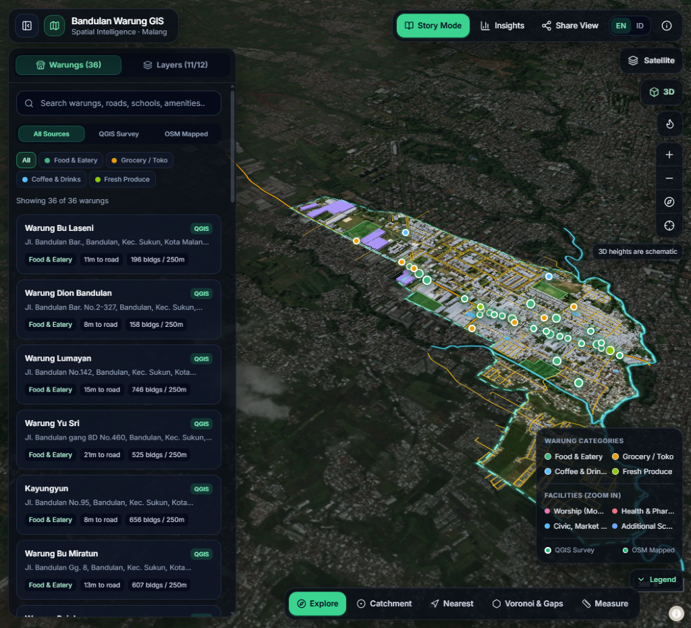

# 🛰️ Bandulan Warung GIS v2

**Satellite-First Spatial Intelligence WebGIS for Local Business & Urban Geography Analysis**

Explore local warungs and neighborhood shops alongside **3,157 clean 3D OpenStreetMap building footprints**, a complete **843-segment connected street network (67 km)**, **58 supporting community facilities**, **client-side Dijkstra street routing**, **3D catchment highlighting**, **clipped Voronoi territories**, **WebGL density heatmaps**, and **spatial insights** in **Kelurahan Bandulan, Kecamatan Sukun, Malang, Indonesia**.

Built with **Vite, React, TypeScript, Tailwind CSS v4, MapLibre GL JS, and Turf.js** — 100% static client-side architecture deployed on **Cloudflare Pages**.

---

## 🌐 Live Demo

[🌐 Live App (Cloudflare Pages)](https://bandulan-warung-gis.pages.dev/) · [💻 View Source](https://github.com/Freddy47588/bandulan-warung-gis)

---

## 🖼️ Preview



> Looking for the original cartographic deliverable? See the preserved [original QGIS thematic map layout](public/images/Layout_Peta_Bandulan.png) (also accessible inside the app's **About** modal).

---

## ✨ Key Capabilities

### Cartography & 3D Urban Visualization
- **Satellite-First Map-First Experience:** Opens directly into a full-viewport WebGL map on **Esri World Imagery** with an **Inverted Spotlight Mask** that subtly dims surroundings outside Kelurahan Bandulan so the study area stands out immediately.
- **Basemap-Adaptive Cartographic Themes:** Instant zero-flicker switching across **Satellite (Esri World Imagery)**, **Smart City Dark (Esri Dark Gray Canvas)**, **Editorial Light (Esri Light Gray Canvas)**, and **OpenStreetMap** — automatically adapting 3D building gradients, road contrast, label halos, spotlight tint, and MapLibre GL v5 **3D Sky & Horizon Fog**.
- **Clean 3D Urban Massing:** Smooth camera tilt (`2D` ↔ `3D`) and WebGL `fill-extrusion` rendering over **3,157 individual OpenStreetMap building footprints** (replacing the original 250 jagged GeoAI blobs), 6 school campuses, and 5 factories.
- **Category-Coded Markers & Progressive Reveal:** Warung beacons are color-coded by category (**Food & Eatery**, **Grocery / Toko**, **Coffee & Drinks**, **Fresh Produce**) with subtle size differentiation for provenance (**QGIS Survey** vs **OSM Mapped**), while the 58 supporting facility points fade in smoothly from `zoom >= 14.5` to keep overview views uncluttered.
- **Collapsible Mini Legend & Haloed Street Labels:** One-click expandable legend chip at bottom-right paired with zoom-responsive street labels.

### Client-Side Spatial Intelligence (Turf.js + Dijkstra)
1. **Catchment / Buffer Analysis (`100m` / `250m` / `500m`):** Select any warung to generate its service buffer, highlight intersecting 3D buildings in luminous emerald while dimming outside massing, count nearby buildings, facilities, schools, factories, green spaces, and neighboring warungs, and export results to **CSV** or **GeoJSON**.
2. **Nearest Warung Finder (Dijkstra Road Routing + Straight Line):** Click anywhere on the map or use browser GPS to route along the real 843-segment Bandulan street graph using client-side binary-heap **Dijkstra shortest-path routing** with animated flowing route dashes, a pulsing origin pin, walking ETA, top-3 ranking, and instant toggle between **Road Route** and **Straight Line**.
3. **Voronoi Service Territories & Coverage Gaps:** Partitions Kelurahan Bandulan into clipped Voronoi service territories across all 36 warungs (area, % share, building count) and highlights residential zones farthest from mapped businesses.
4. **Spatial Insights Dashboard:** Slide-over analytics panel summarizing study area (`230.6 ha`), warung density & source split, road network breakdown (`67 km`), supporting facilities breakdown (`58`), land-use footprints, and **1-click CSV export**.
5. **Interactive Measure Tool:** Click-to-measure multi-segment distances (`m` / `km`) and polygon areas (`m²` / `ha` + perimeter) with undo/clear controls.
6. **Warung Density Heatmap:** One-click WebGL heatmap toggle to visualize local business clustering across Bandulan.

### Exploration, Storytelling & Localization
- **Global Cross-Layer Search & Filters:** Filter warungs by source (**QGIS Survey** vs **OSM Mapped**) and category, or search across warungs, roads, schools, factories, supporting facilities, and green spaces.
- **5-Chapter Guided Story Mode:** One-click narrative tour orchestrating camera transitions, 2D/3D shifts, layer states, 250m catchment highlights, and clipped Voronoi territories.
- **Bilingual (`EN | ID`) & Shareable URL State:** Defaults to **English (`en`)** with instant switching to **Indonesian (`id`)** (`localStorage` + `?lang=`), synchronizing camera position, pitch, basemap, 3D mode, selected warung, and active spatial tool into shareable URLs.

---

## 🧭 Spatial Datasets (12 Layers)

All 12 layers are stored as validated RFC 7946 GeoJSON files under [`public/data/`](public/data/):

| Layer | Geometry | Features | Source | Dataset |
| --- | --- | ---: | --- | --- |
| Warungs & Local Shops | Point | 36 | 10 QGIS Survey + 26 OSM | `warungs.geojson` |
| Bandulan Boundary | MultiPolygon | 1 | QGIS | `boundary.geojson` |
| Main / Arterial Roads | LineString | 6 | OpenStreetMap | `village-roads.geojson` |
| Residential Streets | LineString | 284 | OpenStreetMap | `residential-roads.geojson` |
| Alleys & Paths | LineString | 553 | OpenStreetMap | `alleys.geojson` |
| Buildings *(3D)* | Polygon | 3,157 | OpenStreetMap | `buildings.geojson` |
| Residential Zones | MultiPolygon | 15 | QGIS (+ Turf.js areas) | `residential-areas.geojson` |
| Green Spaces | MultiPolygon | 4 | QGIS | `green-spaces.geojson` |
| Schools *(3D)* | MultiPolygon | 6 | QGIS | `schools.geojson` |
| Factories *(3D)* | MultiPolygon | 5 | QGIS | `factories.geojson` |
| Supporting Facilities | Point | 58 | OpenStreetMap (32 worship, 11 education, 8 health, 7 civic) | `amenities.geojson` |
| Rivers | MultiLineString | 2 | QGIS | `rivers.geojson` |

### Data Provenance & Transparency

- **Hybrid QGIS + OpenStreetMap Pipeline:** Original QGIS survey layers (`boundary`, `warungs` survey, `schools`, `factories`, `green-spaces`, `residential-areas`, `rivers`) are normalized via [`scripts/prepare-geojson.mjs`](scripts/prepare-geojson.mjs) and enriched with real OpenStreetMap features clipped strictly to Kelurahan Bandulan's boundary via [`scripts/enrich-osm.mjs`](scripts/enrich-osm.mjs).
- **GeoAI Building Replacement:** The original 250 GeoAI building polygons (median 43 vertices, up to 666 vertices per polygon, missing southern Bandulan) were replaced with **3,157 clean OpenStreetMap building footprints** (median ≤ 10 vertices) covering the entire Kelurahan.
- **Transparent Tagging:** Every warung is labeled `QGIS Survey` or `OSM Mapped`. 3D building heights use OSM `building:levels` where tagged and schematic heights (`4.5–12 m`) elsewhere for illustrative urban massing.

---

## 🛠️ Technology Stack

| Layer | Technology |
| --- | --- |
| Mapping & 3D WebGL | MapLibre GL JS v5 |
| Spatial Analysis & Routing | Modular Turf.js v7 (`@turf/*`) + Client-side Binary-Heap Dijkstra |
| Frontend & UI | React 19, TypeScript, Tailwind CSS v4, Lucide Icons |
| Build & Test | Vite 6, Vitest |
| Hosting | Cloudflare Pages (static `dist/` + `_redirects` & `_headers`) |
| Data Sources | QGIS + OpenStreetMap (ODbL) |

---

## 📁 Project Structure

```text
bandulan-warung-gis/
├── index.html
├── package.json
├── tsconfig.json
├── vite.config.ts
├── public/
│   ├── _headers                      # Cloudflare Pages cache & security headers
│   ├── _redirects                    # SPA fallback routing
│   ├── favicon.svg
│   ├── data/                         # 12 validated RFC 7946 GeoJSON datasets
│   └── images/
│       ├── Layout_Peta_Bandulan.png  # Preserved original QGIS thematic layout
│       └── map-preview-v2.png        # v2 Satellite 3D spotlight preview
├── scripts/
│   ├── prepare-geojson.mjs           # Reproducible QGIS export -> GeoJSON pipeline
│   └── enrich-osm.mjs                # 3x3 tiled OpenStreetMap extractor & boundary clipper
├── src/
│   ├── data/                         # Layer catalog & parallel GeoJSON loader
│   ├── spatial/                      # Pure Turf.js modules + Dijkstra road router + global search
│   ├── map/                          # MapLibre basemaps, adaptive themes, layer styles & MapCanvas
│   ├── state/                        # App state context & shareable URL sync
│   ├── i18n/                         # EN (default) & ID localization
│   ├── story/                        # 5-chapter Story Mode definitions
│   ├── utils/                        # CSV & GeoJSON export helpers
│   └── components/                   # Floating glassmorphic HUD & MiniLegend
└── tests/                            # Vitest GeoJSON integrity, Turf.js & Dijkstra routing tests
```

---

## 🚀 Running Locally

Requires **Node.js 20+**.

```bash
npm install
npm run dev
```

### Verification & Data Pipeline Commands

```bash
npm run typecheck      # Strict TypeScript check
npm test               # GeoJSON integrity, Turf.js spatial & Dijkstra routing tests
npm run build          # Production build into dist/
npm run preview        # Preview production build locally
npm run prepare:data   # Re-convert base QGIS exports from git history
npm run enrich:osm     # Refresh & clip OpenStreetMap roads, buildings, warungs & amenities
```

---

## ☁️ Cloudflare Pages Deployment

Hosted at [bandulan-warung-gis.pages.dev](https://bandulan-warung-gis.pages.dev/) with automatic root-domain deployment from `main`:

- **Framework preset:** Vite
- **Build command:** `npm run build`
- **Build output directory:** `dist`
- **Routing & caching:** Handled automatically via [`public/_redirects`](public/_redirects) and [`public/_headers`](public/_headers).

No backend server, database, or basemap API key is required.

---

## 🗃️ Attribution

- Original thematic mapping prepared with [QGIS](https://qgis.org/).
- Interactive WebGL rendering powered by [MapLibre GL JS](https://maplibre.org/).
- Spatial analysis powered by [Turf.js](https://turfjs.org/).
- Vector enrichment & road network data © [OpenStreetMap contributors](https://www.openstreetmap.org/copyright) (ODbL).
- Basemap imagery & canvas tiles © Esri World Imagery, Esri Dark/Light Gray Canvas, and OpenStreetMap contributors.
